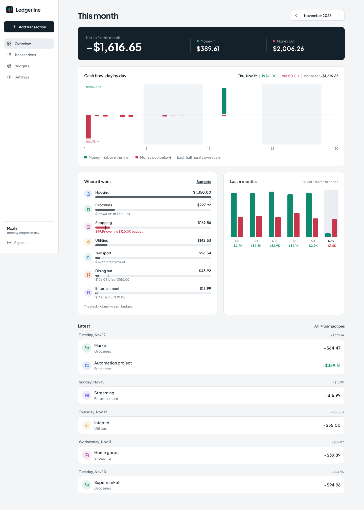
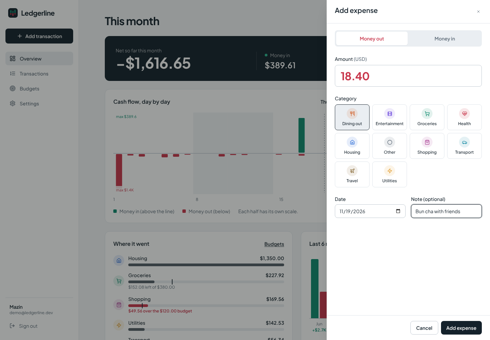
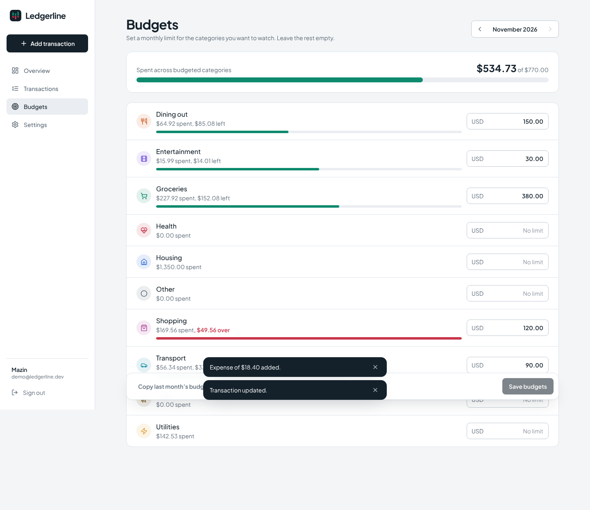
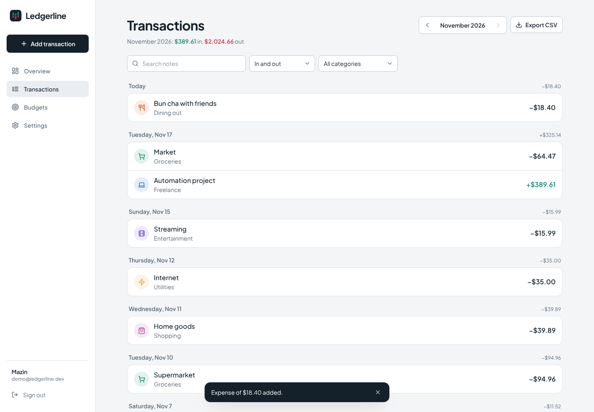
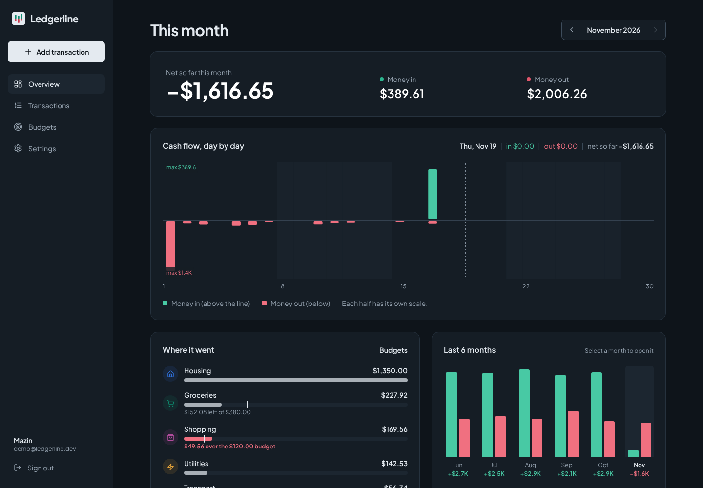
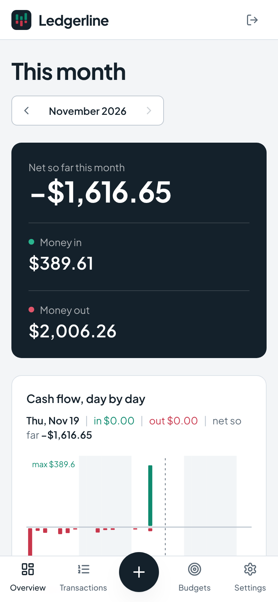

# Ledgerline

A personal expense tracker that answers one question fast: **where did my money go this month?** Log income and spending in a couple of taps, set budgets for the categories you care about, and read the month as a day-by-day cash-flow ribbon.

Built for the **Auspify Technologies Full Stack Development Internship, Task 3 (Expense Tracker)**.



**Live demo:** _add your Vercel link here_ · **Demo login:** `demo@ledgerline.dev` / `Ledger!2026` (6 months of sample data)

## Features

- **Accounts.** Sign up, log in and log out. Every new account starts with 14 ready-made categories.
- **Income and expenses.** Add, edit and delete from anywhere through one drawer. Amounts are stored as exact integer cents, so `0.1 + 0.2` is always `0.30`.
- **Overview.** Shows the month's net, money in and money out, plus:
  - **Cash-flow ribbon.** Money in rises above the line and money out hangs below, one bar per day, with a readout of the running net.
  - **Where it went.** Spending per category, ranked, with budget status inline.
  - **Last 6 months.** Income against spending on one scale, with the net under each month.
- **Budgets.** Monthly limits per category, with meters that turn amber at 80% and red when over. You can copy last month's budgets.
- **Transactions.** Grouped by day, filterable by month, type and category, searchable by note, and exportable to CSV.
- **Settings.** Change your name and display currency (USD, EUR, MAD, VND, CNY, GBP), and create, rename, recolor or delete categories.
- **Works everywhere.** Responsive with a bottom nav and thumb-reach add button on phones, dark mode, keyboard accessible, and a screen-reader table behind each chart.

| | |
| --- | --- |
|  |  |
|  |  |

<p align="center"></p>

## Stack

| Layer | Choice |
| --- | --- |
| Frontend | React 19, Vite, TypeScript, Tailwind CSS, TanStack Query, React Hook Form, Radix UI |
| Charts | Hand-built SVG (no chart library), with accessible fallbacks |
| Backend | Node.js 20, Express 5, TypeScript |
| Database | PostgreSQL with Drizzle ORM and SQL migrations |
| Auth | argon2 password hashes, JWT in an httpOnly cookie |
| Validation | Zod schemas shared by client and server (`shared/`) |
| Tests | Vitest + Supertest (17 API tests, including cross-account isolation), GitHub Actions CI |

## Run it locally

You need Node.js 20+ and a PostgreSQL database. Neon's free tier works; see `DATABASE_SETUP.md` in the parent folder.

```bash
npm install
cp server/.env.example server/.env      # set DATABASE_URL and JWT_SECRET
npm run db:migrate
npm run db:seed                          # demo account + 6 months of data
npm run dev                              # API :4000, app http://localhost:5173
```

`npm test` runs the API tests against the database in `server/.env.test`.

## API

All routes except register and login need a session. Every query is scoped to the signed-in user.

| Method | Route | Purpose |
| --- | --- | --- |
| POST | `/api/auth/register`, `/login`, `/logout` | Account |
| GET / PATCH | `/api/auth/me` | Profile (name, currency) |
| GET / POST | `/api/transactions?month=&type=&categoryId=&search=&page=` | List / create |
| GET / PATCH / DELETE | `/api/transactions/:id` | One transaction (owner only) |
| GET | `/api/transactions/export.csv?…` | CSV of the current filter |
| GET / POST | `/api/categories` | List (with usage counts) / create |
| PATCH / DELETE | `/api/categories/:id` | Edit / delete (refused while in use) |
| GET / PUT | `/api/budgets?month=` | Read / set a month's limits in one transaction |
| GET | `/api/reports/summary?month=` | Totals, daily series, per-category spending vs budget |
| GET | `/api/reports/trend?months=6&end=` | Monthly income vs spending |

## Deploy

1. **Database:** Neon Postgres (free).
2. **API:** Render, using `render.yaml`. Set `DATABASE_URL` and `CLIENT_ORIGIN`. Migrations run on start.
3. **App:** Vercel with root directory `client`. Set `VITE_API_URL` to the Render URL.

See [SECURITY.md](SECURITY.md) for how data is protected.

---

Built by M'hammed Mazin · [github.com/Mazine01](https://github.com/Mazine01) · #Auspify #AuspifyInternship
